# Arsenal Index

102 entries across the 12 categories.
Generated by `scripts/arsenal_search.py --emit-index`. Do not edit by hand; regenerate it after adding or changing an entry.

## CRYPTO (13)

- [`aes-ecb-byte-at-a-time`](CRYPTO/aes-ecb-byte-at-a-time.md) AES-ECB: detection + byte-at-a-time decrypt via oracle
   `aes`, `ecb`, `ecb-penguin`, `byte-at-a-time`, `oracle`, `block-cipher`, `repeated-blocks`, `cut-and-paste`
- [`base64-polyglot-expression`](CRYPTO/base64-polyglot-expression.md) Base64-as-code: generate an expression whose encoding is also valid
   `base64`, `eval`, `polyglot`, `expressao-matematica`, `encoding`, `notacao-cientifica`
- [`custom-weak-hash-bruteforce-collision`](CRYPTO/custom-weak-hash-bruteforce-collision.md) Weak homemade hash: forge a colliding input (same hash, different content) by brute force
   `hash`, `hash-collision`, `custom-hash`, `homemade-hash`, `non-cryptographic`, `weak-hash`, `brute-force`, `xor`
- [`discrete-log-pohlig-hellman-smooth-order`](CRYPTO/discrete-log-pohlig-hellman-smooth-order.md) Discrete log with a smooth group order: Pohlig-Hellman + BSGS + CRT (DH / ElGamal)
   `discrete-log`, `dlog`, `dlp`, `pohlig-hellman`, `smooth-order`, `smooth-p-minus-1`, `b-smooth`, `bsgs`
- [`lcg-truncated-output-state-recovery`](CRYPTO/lcg-truncated-output-state-recovery.md) LCG with truncated output: recover the state (brute force hidden bits or lattice/LLL)
   `lcg`, `linear-congruential-generator`, `truncated-lcg`, `truncated-output`, `top-bits`, `high-bits`, `state-recovery`, `prng`
- [`lsb-image-steganography`](CRYPTO/lsb-image-steganography.md) LSB image steganography (zsteg / stegsolve)
   `stego`, `steganography`, `lsb`, `least-significant-bit`, `png`, `bmp`, `zsteg`, `stegsolve`
- [`malware-config-derived-key-bruteforce`](CRYPTO/malware-config-derived-key-bruteforce.md) Malware config/beacon: derived key + brute force with known-plaintext
   `malware`, `config`, `c2`, `beacon`, `derived-key`, `key-derivation`, `block-cipher`, `aes-cbc`
- [`rsa-common-attacks`](CRYPTO/rsa-common-attacks.md) RSA: decision tree for the common attacks (Fermat / common modulus / low-e / Wiener)
   `rsa`, `fermat`, `common-modulus`, `low-exponent`, `cube-root`, `small-e`, `wiener`, `boneh-durfee`
- [`rsa-franklin-reiter-related-message`](CRYPTO/rsa-franklin-reiter-related-message.md) RSA related messages: Franklin-Reiter polynomial GCD (and the integer-difference shortcut)
   `rsa`, `franklin-reiter`, `related-message`, `related-plaintext`, `gcd-polynomial`, `polynomial-gcd`, `linear-padding`, `known-offset`
- [`rsa-small-n-factorization`](CRYPTO/rsa-small-n-factorization.md) RSA: small or factorable N (Fermat / Pollard rho / factordb)
   `rsa`, `factorization`, `fermat`, `pollard-rho`, `factordb`, `small-n`
- [`shamir-secret-sharing-lagrange-interpolation`](CRYPTO/shamir-secret-sharing-lagrange-interpolation.md) Shamir secret sharing: Lagrange interpolation at f(0), threshold degree and inconsistent shares
   `shamir`, `sss`, `secret-sharing`, `threshold`, `k-of-n`, `shares`, `lagrange`, `lagrange-interpolation`
- [`timestamp-windowed-key-derivation`](CRYPTO/timestamp-windowed-key-derivation.md) Key derived from a discretized timestamp: window brute force
   `timestamp`, `derived-key`, `aes-cbc`, `clock-skew`, `windowed-brute-force`, `md5`
- [`xor-repeating-key`](CRYPTO/xor-repeating-key.md) XOR: 1-byte or repeating key (brute force / known-plaintext)
   `xor`, `single-byte`, `repeating-key`, `crib-drag`, `known-plaintext`, `vigenere-xor`, `brute-force`, `hamming`

## FOR (8)

- [`fat32-unallocated-cluster-recovery`](FOR/fat32-unallocated-cluster-recovery.md) FAT32: find data in an unallocated (unclaimed) cluster, not in slack or live files
   `forensics`, `fat32`, `fat`, `vfat`, `disk-image`, `filesystem`, `unallocated-cluster`, `free-cluster`
- [`file-carving-signature-repair`](FOR/file-carving-signature-repair.md) File carving + magic byte repair (corrupted/embedded file)
   `forensics`, `carving`, `binwalk`, `foremost`, `magic-bytes`, `file-signature`, `header-repair`, `polyglot`
- [`large-artifact-gigabyte-triage`](FOR/large-artifact-gigabyte-triage.md) Gigabyte-scale artifacts: mmap, packed-needle search, streaming walkers and outlier hunting
   `forensics`, `large-file`, `gigabyte`, `1gb`, `mmap`, `streaming`, `binary-search`, `needle-search`
- [`memory-dump-volatility`](FOR/memory-dump-volatility.md) Memory forensics: RAM dump with Volatility 3
   `forensics`, `memory`, `memory-dump`, `volatility`, `volatility3`, `ram`, `pstree`, `cmdline`
- [`pcap-extract-credentials-files`](FOR/pcap-extract-credentials-files.md) PCAP: extract credentials and files from captured traffic
   `forensics`, `pcap`, `pcapng`, `wireshark`, `tshark`, `http`, `ftp`, `export-objects`
- [`registry-shimcache-appcompatcache`](FOR/registry-shimcache-appcompatcache.md) Windows SYSTEM hive: parse ShimCache (AppCompatCache) and cross-check autostart keys
   `forensics`, `windows`, `registry`, `hive`, `system-hive`, `regf`, `shimcache`, `appcompatcache`
- [`sqlite-deleted-record-freeblock-carving`](FOR/sqlite-deleted-record-freeblock-carving.md) SQLite: carve a deleted row from freeblocks, page slack or the freelist
   `forensics`, `sqlite`, `sqlite3`, `deleted-record`, `deleted-row`, `freeblock`, `freelist`, `unallocated`
- [`tcp-overlapping-segment-conflict`](FOR/tcp-overlapping-segment-conflict.md) PCAP: overlapping TCP segments (same seq, different bytes) hidden by stream reassembly
   `forensics`, `pcap`, `tshark`, `wireshark`, `tcp`, `tcp-overlap`, `overlapping-segments`, `same-seq`

## JAIL (2)

- [`bash-restricted-shell-escape`](JAIL/bash-restricted-shell-escape.md) Restricted shell: escaping rbash / a command filter
   `jail`, `rbash`, `restricted-shell`, `shell-escape`, `gtfobins`, `filter-bypass`, `ifs`, `env`
- [`python-sandbox-escape`](JAIL/python-sandbox-escape.md) Python jail: escaping eval/exec with restricted builtins
   `jail`, `pyjail`, `sandbox-escape`, `eval`, `exec`, `builtins`, `subclasses`, `blacklist-bypass`

## LLM (3)

- [`honeypot-anti-ia-token-injection`](LLM/honeypot-anti-ia-token-injection.md) Anti-AI honeypot: token trap / false progress in the prompt and output
   `llm`, `prompt-injection`, `honeypot`, `anti-ai`, `token-trap`, `fake-flag`, `false-progress`, `defensive`
- [`llm-indirect-injection-tooluse`](LLM/llm-indirect-injection-tooluse.md) LLM: indirect injection (via data/RAG) and tool/agent abuse
   `llm`, `indirect-injection`, `injecao-indireta`, `rag`, `tool-use`, `function-calling`, `agent`, `data-exfil`
- [`prompt-injection-system-prompt-leak`](LLM/prompt-injection-system-prompt-leak.md) Prompt injection: leaking the system prompt / flag held by the model
   `llm`, `prompt-injection`, `jailbreak`, `system-prompt`, `guardrail-bypass`, `ignore-previous`, `roleplay`, `encoding-bypass`

## MISC (4)

- [`afsk-bell202-audio-demodulation`](MISC/afsk-bell202-audio-demodulation.md) Audio: demodulate an AFSK (Bell 202, 1200 baud) data burst hidden in a WAV
   `audio`, `wav`, `signal`, `afsk`, `fsk`, `bell-202`, `bell202`, `1200-baud`
- [`encoding-chain-magic`](MISC/encoding-chain-magic.md) MISC: multi-layer encoding chain (CyberChef Magic)
   `encoding`, `cadeia`, `multi-camada`, `base64`, `base32`, `base58`, `base85`, `hex`
- [`git-bundle-tagged-vs-tampered-revision`](MISC/git-bundle-tagged-vs-tampered-revision.md) Git bundle: read the signed/tagged revision, not the tampered HEAD
   `git`, `git-bundle`, `bundle`, `repository`, `version-control`, `annotated-tag`, `signed-tag`, `gpg`
- [`partial-clue-backtracking`](MISC/partial-clue-backtracking.md) Reconstruct a string/flag from partial, ambiguous clues
   `backtracking`, `dfs`, `pruning`, `reconstrucao-de-string`, `pistas-parciais`, `ambiguidade`

## NET (3)

- [`custom-tcp-service-scripting`](NET/custom-tcp-service-scripting.md) Custom TCP service: enumerate the protocol and automate interaction
   `net`, `socket`, `tcp`, `protocol`, `nc`, `pwntools`, `automation`, `banner`
- [`nmap-port-service-recon`](NET/nmap-port-service-recon.md) NET: port/service recon with nmap (initial enumeration)
   `net`, `nmap`, `recon`, `port-scan`, `enumeracao`, `servico`, `versao`, `nse`
- [`scapy-packet-crafting`](NET/scapy-packet-crafting.md) NET: craft/replay packets with scapy
   `net`, `scapy`, `packet-crafting`, `sniff`, `arp`, `icmp`, `raw-socket`, `replay`

## OSINT (7)

- [`domain-recon-certificates-dns`](OSINT/domain-recon-certificates-dns.md) OSINT: passive recon of a domain/IP (CT logs, DNS records, WHOIS, history)
   `osint`, `domain`, `subdomain`, `crt-sh`, `certificate-transparency`, `whois`, `dns`, `txt-record`
- [`email-pivot-account-discovery`](OSINT/email-pivot-account-discovery.md) OSINT: pivot from an email address (or .eml headers) to the person and their accounts
   `osint`, `email`, `gmail`, `ghunt`, `epieos`, `email-headers`, `eml`, `pivot`
- [`image-geolocation-exif`](OSINT/image-geolocation-exif.md) OSINT: geolocate a photo (EXIF + reverse image + visual clues)
   `osint`, `geolocation`, `geolocalizacao`, `exif`, `gps`, `reverse-image`, `exiftool`, `landmark`
- [`social-media-scraping-playwright`](OSINT/social-media-scraping-playwright.md) Automated collection of posts/comments on a social network via Playwright
   `playwright`, `scraping`, `instagram`, `social-media`, `comments`, `browser-automation`
- [`transport-tracking-aircraft-ship-aprs`](OSINT/transport-tracking-aircraft-ship-aprs.md) OSINT: identify and track an aircraft, ship, container or ham-radio station
   `osint`, `aircraft`, `flight`, `tail-number`, `registration`, `ads-b`, `ship`, `vessel`
- [`username-pivot-cross-platform`](OSINT/username-pivot-cross-platform.md) OSINT: pivot a username/handle across platforms to reach the flag
   `osint`, `username`, `alias`, `handle`, `pivot`, `sherlock`, `whatsmyname`, `socmint`
- [`wayback-archived-site-recovery`](OSINT/wayback-archived-site-recovery.md) OSINT: recover deleted or changed web content from archives (Wayback CDX, archive.today)
   `osint`, `wayback`, `archive`, `web-archive`, `cdx`, `deleted-page`, `snapshot`, `archive-today`

## PPC (2)

- [`multiround-timed-service-harness`](PPC/multiround-timed-service-harness.md) PPC: generic harness for a timed, multi-round service
   `ppc`, `programacao-competitiva`, `harness`, `pwntools`, `remote`, `multi-round`, `cronometrado`, `regex`
- [`single-digit-expression-solver`](PPC/single-digit-expression-solver.md) Generate an expression with a repeated digit that hits a target (DP/Fraction)
   `dp`, `memoizacao`, `fracoes`, `expressao-aritmetica`, `protocolo-nc`, `socket`

## PWN (7)

- [`boot2root-methodology-checklist`](PWN/boot2root-methodology-checklist.md) Boot2root box: the 4-stage methodology (ports to user to user.txt to root)
   `boot2root`, `privesc`, `privilege-escalation`, `enumeration`, `methodology`, `checklist`, `foothold`, `sudo`
- [`format-string-leak-write`](PWN/format-string-leak-write.md) Format string: leak (%p) and arbitrary write (%n / GOT overwrite)
   `format-string`, `fmt`, `printf`, `percent-p`, `percent-n`, `got-overwrite`, `leak`, `canary-leak`
- [`ret2shellcode-nx-disabled`](PWN/ret2shellcode-nx-disabled.md) ret2shellcode: inject shellcode with NX disabled
   `shellcode`, `ret2shellcode`, `nx-disabled`, `executable-stack`, `rwx`, `jmp-rsp`, `jmp-esp`, `shellcraft`
- [`stack-bof-ret2win-ret2libc`](PWN/stack-bof-ret2win-ret2libc.md) Stack overflow → ret2win / ret2libc with pwntools
   `bof`, `buffer-overflow`, `ret2win`, `ret2libc`, `rop`, `stack`, `pwntools`, `offset`
- [`sudo-helper-forgeable-mac-gate`](PWN/sudo-helper-forgeable-mac-gate.md) sudo/setuid helper gated by a forgeable HMAC or integrity check
   `privesc`, `sudo`, `hmac`, `mac`, `integrity-check`, `forgery`, `key-reuse`, `leaked-key`
- [`sudo-nopasswd-writable-input-exec`](PWN/sudo-nopasswd-writable-input-exec.md) sudo NOPASSWD wrapper that runs attacker-controlled input as root
   `privesc`, `sudo`, `nopasswd`, `sudoers`, `wrapper-script`, `writable-script`, `bash-c`, `source`
- [`toctou-decompression-overflow-validated-structure`](PWN/toctou-decompression-overflow-validated-structure.md) TOCTOU validator↔consumer: PackBits decompression (unbounded output) rewrites an already-validated structure
   `blockchain`, `bridge`, `toctou`, `time-of-check-time-of-use`, `decompression`, `packbits`, `rle`, `decompression-bomb`

## REV (16)

- [`apk-jni-native-method-check`](REV/apk-jni-native-method-check.md) REV: APK whose real check is a JNI native method in lib/*.so
   `android`, `apk`, `dex`, `classes-dex`, `jni`, `native-method`, `jni-onload`, `registernatives`
- [`arx-keygen-invert-license-check`](REV/arx-keygen-invert-license-check.md) REV: keygen-me (invert the ARX cipher of a license-check validator)
   `keygen`, `arx`, `cipher`, `invert`, `obfuscated-add`, `opaque-predicate`, `dead-code`, `ptrace-antidebug`
- [`bridge-receipt-local-commitment-forge`](REV/bridge-receipt-local-commitment-forge.md) Bridge receipt forge: locally recomputed commitment (self-consistency ≠ authentication) via gdb
   `blockchain`, `bridge`, `relayer`, `guardian`, `receipt`, `commitment`, `self-consistency`, `no-mac`
- [`carcarapack-dynamic-hbreak`](REV/carcarapack-dynamic-hbreak.md) CarcaraPack: dynamic fast-path (hook fexecve + hbreak before the anti-debug)
   `packer`, `self-extracting`, `memfd-create`, `fexecve`, `carcarapack`, `anti-debug`, `hardware-breakpoint`, `hbreak`
- [`decoy-vs-real-checker-what-actually-runs`](REV/decoy-vs-real-checker-what-actually-runs.md) REV: decoy vs real checker (which build, library or pre-main constructor actually runs)
   `decoy`, `decoy-build`, `two-builds`, `posted-build`, `bindiff`, `init-array`, `preinit-array`, `ctors`
- [`dotnet-il-static-analysis`](REV/dotnet-il-static-analysis.md) REV: .NET assembly (IL) static analysis, answers in code Main never prints
   `dotnet`, `.net`, `csharp`, `cil`, `msil`, `il`, `ilspy`, `ilspycmd`
- [`elf-hidden-section-foreign-arch-firmware`](REV/elf-hidden-section-foreign-arch-firmware.md) REV: second program hidden in an unreferenced ELF section (foreign-arch firmware blob)
   `elf`, `readelf`, `section-headers`, `custom-section`, `unreferenced-section`, `progbits`, `objcopy`, `only-section`
- [`flag-check-reverse-transform`](REV/flag-check-reverse-transform.md) Flag check by reversible transform: recover it from the constant
   `reversing`, `flag-check`, `xor`, `decompile`, `ghidra`, `constante-hardcoded`, `strcmp`, `transform`
- [`hidden-check-off-main-path`](REV/hidden-check-off-main-path.md) REV: real check hidden off the obvious path (signal/exception handler, mid-instruction jump, stack pivot)
   `hidden-check`, `decoy`, `control-flow`, `signal-handler`, `sigaction`, `sigtrap`, `int3`, `ucontext`
- [`java-classloader-defineclass-hidden-class`](REV/java-classloader-defineclass-hidden-class.md) REV: hidden Java class decrypted and loaded at runtime (ClassLoader.defineClass)
   `java`, `jar`, `jvm`, `class-file`, `bytecode`, `javap`, `cfr`, `procyon`
- [`pyc-bytecode-decompile`](REV/pyc-bytecode-decompile.md) REV: decompile Python bytecode (.pyc / PyInstaller)
   `pyc`, `python-bytecode`, `bytecode`, `pyinstaller`, `decompile`, `decompyle3`, `uncompyle6`, `pycdc`
- [`self-extracting-packer-memfd-unpack`](REV/self-extracting-packer-memfd-unpack.md) REV: self-extracting packer (memfd_create + fexecve) with payload in the footer
   `packer`, `self-extracting`, `memfd-create`, `fexecve`, `proc-self-exe`, `unpack`, `lz4`, `lcg`
- [`self-modifying-code-mprotect-xor-decrypt`](REV/self-modifying-code-mprotect-xor-decrypt.md) REV: self-modifying code (function encrypted on disk, decrypted at runtime via mprotect + XOR)
   `self-modifying-code`, `smc`, `mprotect`, `virtualprotect`, `rwx`, `xor`, `encrypted-function`, `runtime-decrypt`
- [`static-triage-strings-ltrace`](REV/static-triage-strings-ltrace.md) REV: static triage (quick wins before decompiling)
   `strings`, `ltrace`, `strace`, `triage`, `triagem`, `hardcoded-flag`, `strcmp`, `nm`
- [`vm-bytecode-keygen-z3`](REV/vm-bytecode-keygen-z3.md) REV: keygen with a bytecode VM (model it in z3, key-schedule as a black box)
   `keygen`, `serial`, `vm`, `bytecode`, `virtual-machine`, `z3`, `smt`, `simd`
- [`wasm-module-static-analysis`](REV/wasm-module-static-analysis.md) REV: WebAssembly (.wasm) module analysis (exports, data segment, local instantiate)
   `wasm`, `webassembly`, `wat`, `wabt`, `wasm2wat`, `wasm-objdump`, `wasm-decompile`, `wasm2c`

## TRIVIA (1)

- [`knowledge-question-research`](TRIVIA/knowledge-question-research.md) Trivia: tackling knowledge questions with targeted research
   `trivia`, `research`, `knowledge`, `security`, `cve`, `history`, `flag-format`

## WEB (36)

- [`blockchain-bitcoin-electrum-regtest-seed-recovery`](WEB/blockchain-bitcoin-electrum-regtest-seed-recovery.md) Non-EVM blockchain (Bitcoin/Electrum regtest): SSH pivot + seed phrase → move funds (no Foundry/EVM)
   `blockchain`, `bitcoin`, `not-evm`, `electrum`, `regtest`, `seed-phrase`, `mnemonic`, `wallet-recovery`
- [`client-side-js-dom-browser-inspection`](WEB/client-side-js-dom-browser-inspection.md) Web client-side: flag/logic in the browser (JS/DOM/storage/network) inspected via the chrome-devtools MCP
   `client-side`, `javascript`, `dom`, `spa`, `localstorage`, `sessionstorage`, `indexeddb`, `cookie`
- [`command-injection`](WEB/command-injection.md) Command injection (OS command → RCE)
   `command-injection`, `os-command`, `rce`, `shell`, `blind`, `oob`, `filter-bypass`, `ifs`
- [`error-handler-file-leak`](WEB/error-handler-file-leak.md) File leak via a badly implemented catch
   `error-handling`, `exception`, `type-confusion`, `file-leak`, `catch-block`, `node`, `express`
- [`generic-recon-scanner`](WEB/generic-recon-scanner.md) Generic initial recon: common paths + User-Agent variation
   `recon`, `enumeracao`, `user-agent`, `paths-comuns`, `requests`, `flag-scan`, `web-check`, `web-recon`
- [`jwt-alg-none`](WEB/jwt-alg-none.md) JWT alg:none: signature bypass
   `jwt`, `alg-none`, `auth-bypass`, `token-forge`, `signature`
- [`move-sui-source-encoded-puzzle-input`](WEB/move-sui-source-encoded-puzzle-input.md) Move/Sui: the win is a puzzle encoded in the source; supply the input that satisfies it (not crypto)
   `blockchain`, `sui`, `move`, `not-evm`, `puzzle`, `source-reading`, `nested-if`, `satisfy-input`
- [`move-sui-state-machine-reclaim-reward`](WEB/move-sui-state-machine-reclaim-reward.md) Move/Sui: a claim reachable from an extra state = re-collect the reward in a loop (+ hot-potato ticket)
   `blockchain`, `sui`, `move`, `not-evm`, `state-machine`, `state-transition`, `reentrancy-equivalent`, `reclaim`
- [`move-sui-validated-index-vs-consumed-element`](WEB/move-sui-validated-index-vs-consumed-element.md) Move/Sui: validated index ≠ consumed element (check on quest_id, pop_back pays another)
   `blockchain`, `sui`, `move`, `not-evm`, `validated-index`, `index-confusion`, `check-vs-use`, `toctou`
- [`mtls-client-cert-exchange-chain`](WEB/mtls-client-cert-exchange-chain.md) mTLS: client-cert exchange chain (+ XOR known-plaintext on the next package)
   `mtls`, `client-certificate`, `tls`, `two-way-ssl`, `cert-chain`, `xor`, `known-plaintext`, `pem`
- [`sqli-union-authbypass`](WEB/sqli-union-authbypass.md) SQL injection: auth bypass + UNION + sqlmap
   `sqli`, `sql-injection`, `union`, `union-based`, `auth-bypass`, `login-bypass`, `sqlmap`, `boolean-blind`
- [`ssrf-internal-microservice-ip-leak`](WEB/ssrf-internal-microservice-ip-leak.md) SSRF: enumerating an internal microservice via an IP leaked in an egress error (+ credit-gate bypass)
   `ssrf`, `egress-policy`, `ip-leak`, `microservice`, `openapi`, `swagger`, `internal-api`, `m2m`
- [`ssrf-lfi-filter-bypass`](WEB/ssrf-lfi-filter-bypass.md) SSRF/LFI: URL-filter bypass fuzzing
   `ssrf`, `lfi`, `filtro-de-url`, `file-wrapper`, `php-filter`, `ip-encoding`, `fuzzing`
- [`ssti-template-injection`](WEB/ssti-template-injection.md) SSTI: Server-Side Template Injection (Jinja2 → RCE)
   `ssti`, `template-injection`, `jinja2`, `twig`, `flask`, `server-side`, `rce`, `polyglot`
- [`web3-access-control-nominate`](WEB/web3-access-control-nominate.md) Web3: missing access control (nominate / 2-step owner) + storage reads
   `web3`, `evm`, `solidity`, `access-control`, `ownable`, `ownable2step`, `nominate`, `missing-modifier`
- [`web3-bridge-fake-token-pair-spoof-drain`](WEB/web3-bridge-fake-token-pair-spoof-drain.md) Web3: an L1/L2 bridge that doesn't validate the token pair; a fake token mapped to real WETH drains the bridge
   `web3`, `blockchain`, `evm`, `solidity`, `bridge`, `cross-chain`, `l1`, `l2`
- [`web3-commit-secret-msgsender-gated`](WEB/web3-commit-secret-msgsender-gated.md) Web3: secret/commit-hash gated by msg.sender (keccak slot) + prompt-injection decoy in bytecode + /flag launcher with a token
   `web3`, `blockchain`, `evm`, `solidity`, `anvil`, `chainid-31337`, `issolved`, `setup-contract`
- [`web3-constructor-typo-exposed-initializer`](WEB/web3-constructor-typo-exposed-initializer.md) Web3: exposed initializer (constructor with a typo / legacy pragma) callable by anyone
   `web3`, `blockchain`, `evm`, `solidity`, `constructor`, `initializer`, `typo`, `legacy-pragma`
- [`web3-cross-instance-shared-state-economic-gate`](WEB/web3-cross-instance-shared-state-economic-gate.md) Web3: broken cross-instance isolation + economic-gate bypass (fund the target wallet from another instance)
   `web3`, `blockchain`, `ton`, `tolk`, `jetton`, `cross-instance`, `instance-isolation`, `shared-world`
- [`web3-ctf-launcher-ticket-token-flag-retrieval`](WEB/web3-ctf-launcher-ticket-token-flag-retrieval.md) Web3: retrieving the flag from an instanced launcher (ticket/token/proof + hik_team cookie) after isSolved()
   `web3`, `blockchain`, `ctf-launcher`, `instance.json`, `ticket`, `token`, `flag`, `proof`
- [`web3-delegatecall-storage-collision-proxy`](WEB/web3-delegatecall-storage-collision-proxy.md) Web3: transparent proxy + delegatecall to a helper with an unauthenticated setter (storage collision → takeover)
   `web3`, `blockchain`, `evm`, `solidity`, `delegatecall`, `storage-collision`, `proxy`, `transparent-proxy`
- [`web3-deployed-bytecode-differs-from-source`](WEB/web3-deployed-bytecode-differs-from-source.md) Web3: deployed bytecode ≠ the source you were given; interrogate the live contract (getter/storage) instead of trusting the .sol
   `web3`, `blockchain`, `evm`, `solidity`, `deception`, `source-vs-bytecode`, `decompile`, `trust-the-chain`
- [`web3-mint-on-swap-no-conservation-loop`](WEB/web3-mint-on-swap-no-conservation-loop.md) Web3: a swap that MINTS on both sides (doesn't conserve supply) → loop with the same capital to inflate a counter
   `web3`, `blockchain`, `evm`, `solidity`, `erc20`, `token`, `mint`, `mint-on-swap`
- [`web3-per-block-reset-batch-in-one-tx`](WEB/web3-per-block-reset-batch-in-one-tx.md) Web3: state that resets per block (regeneration) beaten by batching N actions into a single tx
   `web3`, `blockchain`, `evm`, `solidity`, `per-block-reset`, `regeneration`, `self-healing`, `block-timestamp`
- [`web3-receive-fallback-weak-access-control`](WEB/web3-receive-fallback-weak-access-control.md) Web3: owner takeover via receive()/fallback() with weak access control (send ETH outside the ABI)
   `web3`, `blockchain`, `evm`, `solidity`, `receive`, `fallback`, `access-control`, `owner-takeover`
- [`web3-reentrancy-checks-effects-interactions`](WEB/web3-reentrancy-checks-effects-interactions.md) Web3: reentrancy (state updated AFTER the external call) drained by an attacker contract
   `web3`, `blockchain`, `evm`, `solidity`, `reentrancy`, `checks-effects-interactions`, `external-call`, `receive`
- [`web3-setup-issolved-flag-ceremony`](WEB/web3-setup-issolved-flag-ceremony.md) Web3: flag ceremony (ticket/token/proof) + session cookie
   `web3`, `evm`, `solidity`, `setup`, `issolved`, `ticket`, `token`, `proof`
- [`web3-signature-voucher-offbyone-nonce-replay`](WEB/web3-signature-voucher-offbyone-nonce-replay.md) Web3: EIP-712 voucher replay via an off-by-one in the nonce bitmap (airdrop/drop claim)
   `web3`, `blockchain`, `eip712`, `signature`, `voucher`, `airdrop`, `drop`, `claim`
- [`web3-signed-int-cast-unsigned-underflow`](WEB/web3-signed-int-cast-unsigned-underflow.md) Web3: signed bound/value validated by <= then cast to unsigned = underflow → giant payout
   `web3`, `blockchain`, `evm`, `solidity`, `integer`, `signed`, `int64`, `uint64`
- [`web3-spot-price-oracle-amm-flashloan-manipulation`](WEB/web3-spot-price-oracle-amm-flashloan-manipulation.md) Web3: oracle reads spot price straight from AMM reserves; flash-loan pump to inflate collateral and drain the lending desk
   `web3`, `blockchain`, `evm`, `defi`, `amm`, `dex`, `oracle`, `spot-price`
- [`web3-storage-mapping-secret`](WEB/web3-storage-mapping-secret.md) Web3: recover a mapping secret (keccak slot) + eth_call as an oracle
   `web3`, `evm`, `solidity`, `storage`, `mapping`, `keccak`, `slot`, `eth-call-oracle`
- [`web3-token-mint-hook-reentrancy`](WEB/web3-token-mint-hook-reentrancy.md) Web3: reentrancy through the mint/transfer HOOK of a custom token (ETH leg protected by the stipend, token callback with free gas)
   `web3`, `blockchain`, `evm`, `solidity`, `reentrancy`, `mint-hook`, `transfer-hook`, `erc777`
- [`web3-tx-origin-owner-visit`](WEB/web3-tx-origin-owner-visit.md) Web3: tx.origin phishing via owner-visit (+ the estimateGas trick)
   `web3`, `evm`, `solidity`, `tx-origin`, `phishing`, `owner-visit`, `access-control`, `estimategas`
- [`web3-tx-origin-vs-msgsender-auth-bypass`](WEB/web3-tx-origin-vs-msgsender-auth-bypass.md) Web3: tx.origin vs msg.sender check; calling via an intermediary contract breaks the condition (auth bypass)
   `web3`, `blockchain`, `evm`, `solidity`, `tx.origin`, `msg.sender`, `authentication`, `authorization`
- [`web3-unprotected-beacon-proxy-upgrade`](WEB/web3-unprotected-beacon-proxy-upgrade.md) Web3: unauthenticated beacon/proxy upgrade → swap the implementation for a fake one that passes the checks
   `web3`, `blockchain`, `evm`, `solidity`, `beacon`, `proxy`, `upgradeable`, `upgrade`
- [`web3-weak-onchain-randomness-blockhash`](WEB/web3-weak-onchain-randomness-blockhash.md) Web3: predictable on-chain randomness (blockhash/timestamp) replicated by an attacker contract
   `web3`, `blockchain`, `evm`, `solidity`, `randomness`, `prng`, `blockhash`, `block-timestamp`

## Relationship graph

Entries connected through their `related` field.

```mermaid
flowchart LR
  n0["aes-ecb-byte-at-a-time"]
  n1["afsk-bell202-audio-demodulation"]
  n2["apk-jni-native-method-check"]
  n3["arx-keygen-invert-license-check"]
  n4["base64-polyglot-expression"]
  n5["bash-restricted-shell-escape"]
  n6["blockchain-bitcoin-electrum-regtest-seed-recovery"]
  n7["boot2root-methodology-checklist"]
  n8["bridge-receipt-local-commitment-forge"]
  n9["carcarapack-dynamic-hbreak"]
  n10["client-side-js-dom-browser-inspection"]
  n11["command-injection"]
  n12["custom-tcp-service-scripting"]
  n13["custom-weak-hash-bruteforce-collision"]
  n14["decoy-vs-real-checker-what-actually-runs"]
  n15["discrete-log-pohlig-hellman-smooth-order"]
  n16["domain-recon-certificates-dns"]
  n17["dotnet-il-static-analysis"]
  n18["elf-hidden-section-foreign-arch-firmware"]
  n19["email-pivot-account-discovery"]
  n20["encoding-chain-magic"]
  n21["fat32-unallocated-cluster-recovery"]
  n22["file-carving-signature-repair"]
  n23["flag-check-reverse-transform"]
  n24["format-string-leak-write"]
  n25["generic-recon-scanner"]
  n26["hidden-check-off-main-path"]
  n27["honeypot-anti-ia-token-injection"]
  n28["image-geolocation-exif"]
  n29["java-classloader-defineclass-hidden-class"]
  n30["large-artifact-gigabyte-triage"]
  n31["lcg-truncated-output-state-recovery"]
  n32["llm-indirect-injection-tooluse"]
  n33["lsb-image-steganography"]
  n34["malware-config-derived-key-bruteforce"]
  n35["memory-dump-volatility"]
  n36["move-sui-source-encoded-puzzle-input"]
  n37["move-sui-state-machine-reclaim-reward"]
  n38["move-sui-validated-index-vs-consumed-element"]
  n39["mtls-client-cert-exchange-chain"]
  n40["multiround-timed-service-harness"]
  n41["nmap-port-service-recon"]
  n42["pcap-extract-credentials-files"]
  n43["prompt-injection-system-prompt-leak"]
  n44["pyc-bytecode-decompile"]
  n45["python-sandbox-escape"]
  n46["registry-shimcache-appcompatcache"]
  n47["ret2shellcode-nx-disabled"]
  n48["rsa-common-attacks"]
  n49["rsa-franklin-reiter-related-message"]
  n50["rsa-small-n-factorization"]
  n51["scapy-packet-crafting"]
  n52["self-extracting-packer-memfd-unpack"]
  n53["self-modifying-code-mprotect-xor-decrypt"]
  n54["shamir-secret-sharing-lagrange-interpolation"]
  n55["single-digit-expression-solver"]
  n56["social-media-scraping-playwright"]
  n57["sqli-union-authbypass"]
  n58["sqlite-deleted-record-freeblock-carving"]
  n59["ssrf-internal-microservice-ip-leak"]
  n60["ssrf-lfi-filter-bypass"]
  n61["ssti-template-injection"]
  n62["stack-bof-ret2win-ret2libc"]
  n63["static-triage-strings-ltrace"]
  n64["sudo-helper-forgeable-mac-gate"]
  n65["sudo-nopasswd-writable-input-exec"]
  n66["tcp-overlapping-segment-conflict"]
  n67["timestamp-windowed-key-derivation"]
  n68["toctou-decompression-overflow-validated-structure"]
  n69["transport-tracking-aircraft-ship-aprs"]
  n70["username-pivot-cross-platform"]
  n71["vm-bytecode-keygen-z3"]
  n72["wasm-module-static-analysis"]
  n73["wayback-archived-site-recovery"]
  n74["web3-access-control-nominate"]
  n75["web3-bridge-fake-token-pair-spoof-drain"]
  n76["web3-commit-secret-msgsender-gated"]
  n77["web3-constructor-typo-exposed-initializer"]
  n78["web3-cross-instance-shared-state-economic-gate"]
  n79["web3-ctf-launcher-ticket-token-flag-retrieval"]
  n80["web3-delegatecall-storage-collision-proxy"]
  n81["web3-deployed-bytecode-differs-from-source"]
  n82["web3-mint-on-swap-no-conservation-loop"]
  n83["web3-per-block-reset-batch-in-one-tx"]
  n84["web3-receive-fallback-weak-access-control"]
  n85["web3-reentrancy-checks-effects-interactions"]
  n86["web3-setup-issolved-flag-ceremony"]
  n87["web3-signature-voucher-offbyone-nonce-replay"]
  n88["web3-signed-int-cast-unsigned-underflow"]
  n89["web3-spot-price-oracle-amm-flashloan-manipulation"]
  n90["web3-storage-mapping-secret"]
  n91["web3-token-mint-hook-reentrancy"]
  n92["web3-tx-origin-owner-visit"]
  n93["web3-tx-origin-vs-msgsender-auth-bypass"]
  n94["web3-unprotected-beacon-proxy-upgrade"]
  n95["web3-weak-onchain-randomness-blockhash"]
  n96["xor-repeating-key"]
  n4 --> n55
  n15 --> n50
  n31 --> n67
  n31 --> n13
  n34 --> n96
  n34 --> n67
  n34 --> n0
  n48 --> n50
  n48 --> n49
  n49 --> n48
  n49 --> n50
  n54 --> n31
  n96 --> n4
  n21 --> n30
  n21 --> n22
  n22 --> n35
  n22 --> n33
  n22 --> n18
  n30 --> n58
  n30 --> n21
  n30 --> n46
  n30 --> n66
  n30 --> n42
  n30 --> n22
  n35 --> n42
  n46 --> n30
  n46 --> n35
  n58 --> n30
  n58 --> n22
  n66 --> n42
  n66 --> n30
  n5 --> n45
  n27 --> n43
  n27 --> n32
  n32 --> n43
  n1 --> n20
  n20 --> n4
  n12 --> n4
  n41 --> n12
  n41 --> n51
  n51 --> n12
  n16 --> n73
  n16 --> n19
  n16 --> n41
  n19 --> n70
  n19 --> n16
  n28 --> n56
  n28 --> n69
  n69 --> n28
  n69 --> n1
  n70 --> n19
  n70 --> n56
  n73 --> n16
  n73 --> n70
  n40 --> n55
  n55 --> n4
  n7 --> n41
  n7 --> n65
  n7 --> n64
  n7 --> n11
  n24 --> n62
  n47 --> n62
  n62 --> n26
  n64 --> n7
  n64 --> n65
  n64 --> n96
  n65 --> n7
  n65 --> n64
  n65 --> n11
  n68 --> n8
  n2 --> n23
  n2 --> n63
  n2 --> n14
  n2 --> n29
  n3 --> n23
  n3 --> n63
  n8 --> n68
  n9 --> n52
  n9 --> n53
  n14 --> n26
  n14 --> n53
  n14 --> n63
  n14 --> n23
  n17 --> n63
  n17 --> n23
  n17 --> n29
  n17 --> n14
  n18 --> n63
  n18 --> n52
  n18 --> n53
  n18 --> n23
  n23 --> n53
  n23 --> n26
  n23 --> n14
  n23 --> n2
  n23 --> n72
  n23 --> n29
  n26 --> n53
  n26 --> n23
  n26 --> n63
  n26 --> n14
  n29 --> n17
  n29 --> n18
  n29 --> n2
  n29 --> n23
  n44 --> n63
  n52 --> n63
  n52 --> n23
  n53 --> n63
  n53 --> n23
  n53 --> n14
  n53 --> n26
  n63 --> n23
  n63 --> n53
  n63 --> n26
  n63 --> n14
  n63 --> n2
  n63 --> n18
  n71 --> n3
  n71 --> n23
  n72 --> n63
  n72 --> n23
  n72 --> n14
  n6 --> n78
  n10 --> n72
  n11 --> n61
  n11 --> n7
  n36 --> n38
  n36 --> n94
  n37 --> n38
  n37 --> n85
  n38 --> n68
  n38 --> n85
  n39 --> n96
  n57 --> n25
  n59 --> n60
  n74 --> n86
  n74 --> n90
  n75 --> n78
  n75 --> n88
  n77 --> n84
  n77 --> n76
  n78 --> n85
  n79 --> n80
  n79 --> n94
  n80 --> n85
  n80 --> n84
  n81 --> n76
  n81 --> n77
  n82 --> n78
  n82 --> n83
  n83 --> n95
  n83 --> n85
  n84 --> n76
  n85 --> n84
  n85 --> n95
  n85 --> n80
  n86 --> n92
  n86 --> n74
  n86 --> n90
  n87 --> n79
  n87 --> n83
  n87 --> n88
  n88 --> n95
  n88 --> n84
  n89 --> n79
  n89 --> n81
  n89 --> n82
  n90 --> n86
  n90 --> n74
  n91 --> n85
  n91 --> n84
  n91 --> n79
  n92 --> n86
  n92 --> n74
  n93 --> n84
  n93 --> n95
  n93 --> n77
  n94 --> n80
  n94 --> n77
  n94 --> n76
  n95 --> n84
  n95 --> n77
```

## Toolsets

External tools for `arsenal_search.py --tools <query>` / `--toolset <name>`.

| Toolset | Tools | Covers |
|---|---|---|
| [`net/vuln-db`](NET/tools/vuln-db.json) | 8 | Look up CVEs and public exploits for an identified product/version. |
| [`osint/archives`](OSINT/tools/archives.json) | 11 | Past versions of web pages and historical newspapers. |
| [`osint/domain-infra`](OSINT/tools/domain-infra.json) | 29 | Technical footprinting of a domain or IP: certificates, DNS, WHOIS, ASN, exposed services, default creds. |
| [`osint/email`](OSINT/tools/email.json) | 12 | Pivot from an email address (or a company domain) to accounts, names, format and headers. |
| [`osint/files-buckets`](OSINT/tools/files-buckets.json) | 5 | Find exposed files: open cloud buckets, public drives, FTP indexes, PDF internals. |
| [`osint/geo-maps`](OSINT/tools/geo-maps.json) | 21 | Maps, street-level and satellite imagery, sun/shadow time math, Wi-Fi geolocation, webcams. |
| [`osint/image-reverse`](OSINT/tools/image-reverse.json) | 9 | Reverse image and face search; {q} is a public image URL. |
| [`osint/leaks`](OSINT/tools/leaks.json) | 3 | Check whether an email/domain appears in known breaches or leak indexes (lookup only). |
| [`osint/phone`](OSINT/tools/phone.json) | 4 | Pivot from a phone number to carrier, line type and owner name. |
| [`osint/records`](OSINT/tools/records.json) | 15 | Company registries, filings, genealogy, patents and academic records. |
| [`osint/search-dorking`](OSINT/tools/search-dorking.json) | 14 | Search indexes beyond Google, curated custom search engines and source-code search. |
| [`osint/socmint-platforms`](OSINT/tools/socmint-platforms.json) | 11 | Platform-specific helpers for Facebook, X, LinkedIn, Instagram, Reddit and Strava. |
| [`osint/transport`](OSINT/tools/transport.json) | 11 | Track aircraft, ships, containers, trains, ham-radio stations and parcels. |
| [`osint/username`](OSINT/tools/username.json) | 6 | Find every account that shares a handle/alias across sites (username pivot). |
| [`osint/video`](OSINT/tools/video.json) | 8 | YouTube/video metadata, upload time, location, transcripts and removed videos. |
