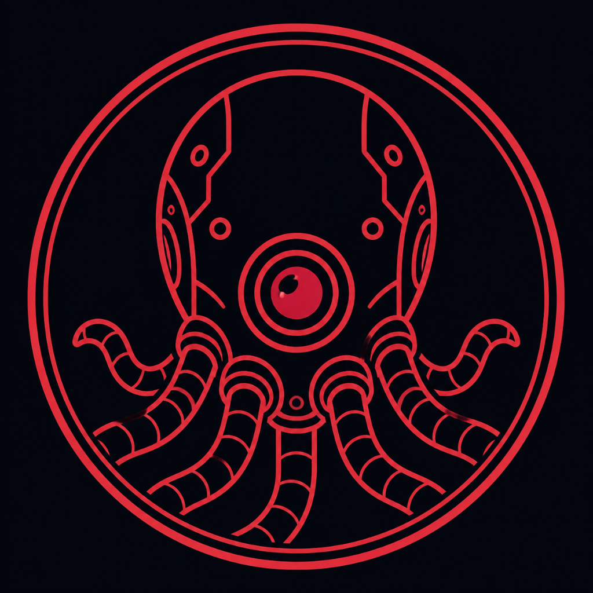
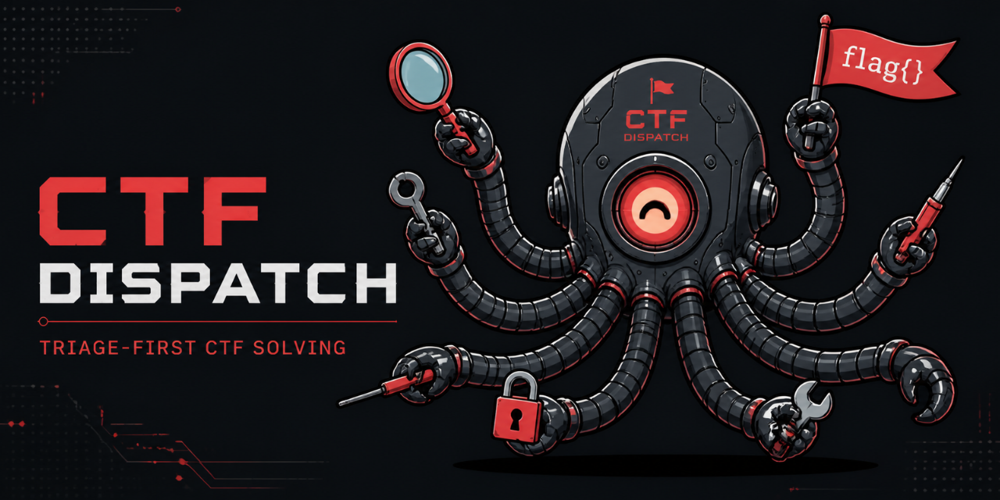
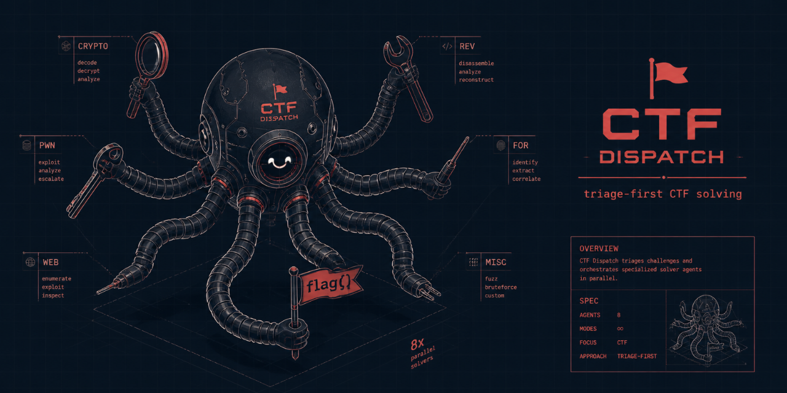

<p align="center">
  
</p>

<h1 align="center">CTF Dispatch</h1>

<p align="center">
  <em>One head, many arms. It triages the challenge and dispatches the right specialist — and never strikes without your say-so.</em>
</p>

<p align="center">
  
  
  
  
  
</p>

<p align="center">
  
</p>

<p align="center">
  <sub>Use only against targets you are authorized to attack — a CTF, a lab, or a competition you are playing.</sub>
</p>

---

A CTF challenge lands and you have twelve ways to be wrong about it. **CTF Dispatch** is the
orchestrator that reads the challenge first, figures out what kind of problem it is, pulls the
method that has worked before from a bundled **Arsenal**, and hands it to the one specialist agent
that should take it — crypto, pwn, web, reversing, forensics, and eight more.

It is an octopus: one head that thinks, many arms that act. And it has one rule it never breaks —
**it stops and asks you before any arm moves.**

## How it works

Dispatch runs one challenge through a fixed pipeline:

1. **Triage** — the `brainstormer` agent reads the raw challenge (text + any attachments) and infers the likely category and attack vectors.
2. **Arsenal lookup** — it searches the bundled Arsenal (SQLite FTS5) for a documented method matching that pattern, and cross-references the relevant tool manual.
3. **Human checkpoint** — it shows you the category, the triage summary, the matching Arsenal entry, and a recommended approach, then **stops and waits** for your call: accept / reject / redirect / refine / ask.
4. **Dispatch** — only after you accept does it hand the challenge to the matching `solver-<category>`, which validates any flag it finds against your configured flag format.

<p align="center">
  
</p>

## The checkpoint

This is the whole point. `/dispatch` always pauses after triage + Arsenal lookup and presents a
recommendation. **No `solver-*` agent runs until you answer.** It is a process rule baked into the
orchestrator and every solver, not a suggestion — so an AI never fires an exploit at a target on
its own initiative. You stay in the loop on every challenge.

## What's inside

- **`/dispatch`** — the orchestrator (triage → Arsenal lookup → checkpoint → solver).
- **13 agents** — `brainstormer` (triage) + 12 category solvers: CRYPTO, REV, PWN, FOR, JAIL, OSINT, NET, WEB, PPC, MISC, TRIVIA, LLM.
- **`/ctf-dispatch:ctf-solve`** — a per-category shortcut that preloads the right playbook and routes into `/dispatch`.
- **`/ctf-dispatch:setflag`** — set the flag format your CTF uses.
- **Arsenal** — ~75 problem-pattern → method entries across the 12 categories, searched with a stdlib-only SQLite FTS5 index (`scripts/arsenal_search.py`).
- **Manuals** — per-tool references (Ghidra, CyberChef, JWT, pwntools, Wireshark, sqlmap, …).

## Install

**Claude Code**, as two commands:

```
/plugin marketplace add Felipebc2/Dispatch
```
```
/plugin install ctf-dispatch@dispatch
```

**Develop locally:** `claude --plugin-dir /path/to/this/repo`.

> Only install CTF Dispatch from `Felipebc2/Dispatch` on GitHub.

## Flag format

Solvers validate a found flag against your CTF's flag format. Set it either way:

- **At install:** the `flag_format` plugin option (default `flag{...}`).
- **At runtime:** `/ctf-dispatch:setflag "HTB{...}"` — persists across plugin updates and overrides the install default. Run it with no argument to see the current value.

## Commands

| Command | What it does |
|---------|--------------|
| `/dispatch [CATEGORY] "<context>"` | Triage a challenge, search the Arsenal, and stop at the human checkpoint with a recommendation. Optional category hint: one of the 12 tags. |
| `/ctf-dispatch:ctf-solve` | Shortcut that identifies the category, preloads its playbook, and routes into `/dispatch`. |
| `/ctf-dispatch:setflag "<format>"` | Set (or, with no argument, show) the flag format solvers validate against. |

The `brainstormer` and `solver-*` agents are invoked **by the orchestrator** at the right step —
you don't call them directly.

## Optional MCP servers

`solver-pwn` and `solver-rev` can use the `ghidra` and `pwndbg` MCP servers if you have them
configured. They are **optional** — the solvers degrade to plain Bash tooling when the MCP servers
aren't present.

## Extending the Arsenal

The Arsenal is meant to grow. Each entry is a `Arsenal/<CATEGORY>/<slug>.md` file with a small YAML
frontmatter (see [`Arsenal/README.md`](Arsenal/README.md) for the schema) describing how to
recognize a problem pattern and the method that solves it. The search index rebuilds incrementally
on the next `arsenal_search.py` call — no manual reindex needed.

Got a pattern that isn't covered? PRs welcome — fork, add your entry (and a tool manual if it needs
one), and open a pull request.

## FAQ

**Does it run attacks on its own?**
No. Every challenge stops at the human checkpoint; no solver runs without your explicit approval.

**Is it tied to one CTF or flag format?**
No. The flag format is configurable (`/ctf-dispatch:setflag`), and the Arsenal is generic technique
knowledge, not event-specific challenges.

**Can I add my own techniques?**
Yes — that's the point. Add an Arsenal entry and open a PR. See [Extending the Arsenal](#extending-the-arsenal).

**Do I need Ghidra / pwndbg?**
Only if you want them. The reversing and pwn solvers use those MCP servers when present and fall
back to Bash tooling when not.

**Is this legal?**
Only against targets you are authorized to attack — a CTF, a lab, or a competition you are playing.
Don't point it at anything else.

## License

[MIT](LICENSE). See [CHANGELOG.md](CHANGELOG.md) for release notes.
